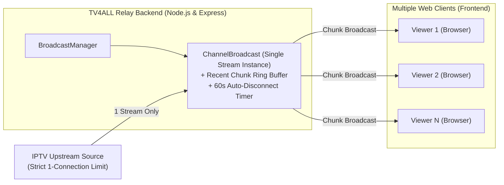

# TV4ALL - Single-Source IPTV Relay & Web Streaming Platform

[](https://github.com/moxeb/tv4all/actions/workflows/ci-cd.yml)


**TV4ALL** is a high-performance IPTV relay and web streaming platform. It solves the common limitation where IPTV providers permit only **one concurrent connection** per subscriber/stream URL. By acting as an intelligent intermediary broadcast proxy, `TV4ALL` opens a **single upstream connection** to the stream provider and broadcasts that live MPEG-TS / HLS stream to **multiple downstream web viewers simultaneously**.

---

## Table of Contents

- [Core Features](#core-features)
- [How It Works (Relay Architecture)](#how-it-works-relay-architecture)
- [Project Structure](#project-structure)
- [Quick Start](#quick-start)
- [User Roles & Authentication](#user-roles--authentication)
- [Configuration & Environment Variables](#configuration--environment-variables)
- [API Reference](#api-reference)
- [Frontend Overview](#frontend-overview)
- [Channel Management (Admin)](#channel-management-admin)
- [Internationalization (i18n)](#internationalization-i18n)
- [Daily Audit Logging](#daily-audit-logging)
- [Automated Regression Tests](#automated-regression-tests)
- [GitHub Actions CI/CD](#github-actions-cicd)
- [Production Deployment](#production-deployment)
- [Security Model](#security-model)

---

## Core Features

- **Single-Source Broadcast Relay**: Connects to the IPTV stream source only once. Fans out incoming video chunks in real-time across unlimited simultaneous viewers.
- **Auto-Disconnect & Bandwidth Saver**: Automatically terminates the upstream IPTV broadcast after 60 seconds of zero active viewers.
- **Recent Chunk Buffer**: Maintains a circular buffer of recent MPEG-TS/HLS chunks so newly connected viewers start playback instantly with no buffering delay.
- **Low-Latency Web Player**: Powered by `mpegts.js` (primary) and `hls.js` (fallback) with unmuted high-fidelity audio, full volume retention, and error recovery.
- **Dual-Mode Channel Management (Admin Only)**:
  - **Form Fields**: Standard name, URL, group category, logo URL, and channel ID.
  - **Raw 2-Line M3U**: Direct copy-paste of standard `#EXTINF:` directive and stream URL.
  - **Safe Deletion**: Channel deletion modal with automatic active broadcast termination and playlist sync.
  - **Automatic ID Deduplication**: Ensures non-conflicting IDs (e.g. `channel-2`, `channel-3`) without crashing existing playlists.
- **Multi-Role Authentication**: 12-hour signed JWT sessions with granular role checks (`admin` vs. standard `viewer`).
- **Tri-lingual Internationalization**: English, French, and Spanish with live runtime switching and `localStorage` persistence.
- **Search & Categorization**: Real-time query highlighting in channel names, group filter dropdown, and sorting (Default, A-Z, Z-A).
- **Electronic Program Guide (EPG)**: Displays live show title, category, elapsed time progress bar, and upcoming scheduled programs directly below the video player.
- **Comprehensive Test Suite**: 118 automated regression tests (76 backend, 42 frontend) validating all core business logic and API contracts.

---

## How It Works (Relay Architecture)



1. When **Viewer 1** tunes in to a channel, the backend's `BroadcastManager` instantiates a `ChannelBroadcast`.
2. A single HTTP client fetches the upstream stream (`.ts`, `.m3u8`, or raw MPEG-TS).
3. As stream chunks arrive, they are placed in a memory ring buffer and immediately piped to Viewer 1's HTTP response.
4. When **Viewer 2** connects to the same channel, the backend does **not** contact the IPTV provider again; it joins the existing broadcast and receives the buffered chunks and all subsequent live chunks.
5. When all viewers leave, a 60-second countdown begins. If no viewers reconnect within 60s, the upstream broadcast is closed gracefully.

---

## Project Structure

```
tv4all/
├── .github/
│   └── workflows/
│       └── ci-cd.yml             # GitHub Actions CI/CD Pipeline
├── backend/                      # Node.js + Express + TypeScript Backend
│   ├── logs/                     # Daily audit logs (YYYY-MM-DD.log)
│   ├── src/
│   │   ├── index.ts              # Express application & server entry point
│   │   ├── middleware/
│   │   │   ├── authMiddleware.ts # JWT token validation & requireAdmin
│   │   │   └── loggerMiddleware.ts # HTTP request logger & IP normalizer
│   │   ├── routes/
│   │   │   ├── authRoutes.ts     # /api/auth (login & /me)
│   │   │   ├── channelRoutes.ts  # /api/channels (CRUD, raw M3U, groups)
│   │   │   ├── groupRoutes.ts    # /api/groups
│   │   │   ├── logRoutes.ts      # /api/logs
│   │   │   └── streamRoutes.ts   # /api/stream/:channelId (relay connection)
│   │   ├── services/
│   │   │   ├── authService.ts    # User credential & JWT handling
│   │   │   ├── channelService.ts # M3U playlist file management
│   │   │   ├── loggerService.ts  # Daily rotating file logger
│   │   │   └── broadcast/
│   │   │       ├── BroadcastManager.ts # Active broadcast pool
│   │   │       └── ChannelBroadcast.ts # Individual stream relay
│   │   ├── types/
│   │   │   ├── broadcast.ts      # Broadcast summary interfaces
│   │   │   ├── channel.ts        # Channel & Group types
│   │   │   └── express.d.ts      # Express Request type extensions
│   │   └── utils/
│   │       └── m3uParser.ts      # Parser for #EXTM3U and attributes
│   ├── tests/                    # 76 Backend Regression Tests (node:test)
│   │   ├── auth.test.ts
│   │   ├── channels.test.ts
│   │   ├── epg.test.ts
│   │   ├── healthAndStream.test.ts
│   │   ├── helpers.ts
│   │   ├── logger.test.ts
│   │   ├── m3uParser.test.ts
│   │   └── run.ts                # Test runner with spec reporter
│   ├── .env.example
│   ├── package.json
│   └── tsconfig.json
├── frontend/                     # React 18 + Vite + Tailwind CSS Frontend
│   ├── public/
│   │   └── logo.svg              # App icon
│   ├── src/
│   │   ├── components/
│   │   │   ├── ChannelCard.tsx   # Channel list item with logo & search highlight
│   │   │   ├── FilterPopover.tsx # Sort order & category modal
│   │   │   ├── LanguageSelector.tsx # EN/FR/ES dropdown selector
│   │   │   ├── Logo.tsx          # Brand display component
│   │   │   ├── VideoPlayer.tsx   # mpegts.js & hls.js video player
│   │   │   └── EPGGuide.tsx      # Electronic Program Guide (Live Now & Up Next)
│   │   ├── config/
│   │   │   └── api.ts            # API endpoint configuration
│   │   ├── context/
│   │   │   └── AuthContext.tsx   # Global auth state & token persistence
│   │   ├── locales/
│   │   │   ├── en.json           # English translations
│   │   │   ├── es.json           # Spanish translations
│   │   │   └── fr.json           # French translations
│   │   ├── pages/
│   │   │   ├── HomePage.tsx      # Main streaming UI & drawer
│   │   │   ├── LoginPage.tsx     # Authentication form
│   │   │   └── ManageChannelsPage.tsx # Admin channel CRUD & M3U manager
│   │   ├── test/                 # 42 Frontend Regression Tests (Vitest)
│   │   │   ├── components/
│   │   │   ├── context/
│   │   │   ├── pages/
│   │   │   ├── setup.ts
│   │   │   └── test-utils.tsx
│   │   ├── App.tsx               # Route definitions
│   │   ├── i18n.ts               # i18next initialization & storage
│   │   ├── index.css             # Tailwind CSS styles & custom scrollbars
│   │   └── main.tsx              # React DOM render root
│   ├── .env.example
│   ├── package.json
│   ├── tsconfig.json
│   └── vite.config.ts
├── index.m3u8                    # Channel playlist source file
├── package.json                  # Root monorepo workspace scripts
├── start.bat                     # Windows CMD one-click launcher
├── start.ps1                     # Windows PowerShell launcher
└── start.sh                      # Linux / macOS / WSL launcher
```

---

## Quick Start

### Prerequisites
- **Node.js**: `v20.x` or higher (verified with Node v20.19+)
- **NPM**: `v9.x` or higher

### Installation

Clone the repository and install dependencies in all workspaces:

```bash
# 1. Clone repository
git clone https://github.com/moxeb/tv4all.git
cd tv4all

# 2. Install root dependencies
npm install

# 3. Install backend dependencies
npm --prefix backend install

# 4. Install frontend dependencies
npm --prefix frontend install
```

### Running Both Backend and Frontend

You can run both services concurrently with a single command:

```bash
npm run dev
# or
npm start
```

Alternatively, use the platform-specific scripts:
- **Windows (Double-click or CMD)**: `start.bat`
- **Windows (PowerShell)**: `.\start.ps1`
- **macOS / Linux / WSL**: `./start.sh`

Once running:
- **Web Player (Frontend)**: [http://localhost:3000](http://localhost:3000)
- **Relay API (Backend)**: [http://localhost:5000](http://localhost:5000)

---

## User Roles & Authentication

The platform provides role-based access control with two user tiers configured through environment variables:

| Role | Privileges | Configured Via (`backend/.env`) |
| --- | --- | --- |
| **Administrator** | Full access: View all streams, add channels (form & raw M3U), delete channels | `ADMIN_USERNAME`, `ADMIN_PASSWORD` |
| **Standard Viewer** | Stream playback, search, filter, and language switcher (read-only) | `AUTH_USERNAME`, `AUTH_PASSWORD` |

> [!TIP]
> Always configure unique, secure usernames and passwords in your `backend/.env` file before running the application. Never commit live credentials or secret keys to version control.

---

## Configuration & Environment Variables

### Backend (`backend/.env`)

Create `backend/.env` based on `backend/.env.example`:

```ini
PORT=5000
NODE_ENV=development

# Path to the M3U playlist file (defaults to root index.m3u8 if omitted)
CHANNELS_FILE_PATH=../index.m3u8

# Standard viewer credentials
AUTH_USERNAME=your_viewer_username
AUTH_PASSWORD=your_viewer_password

# Administrator credentials
ADMIN_USERNAME=your_admin_username
ADMIN_PASSWORD=your_admin_password

# JWT secret key & expiration
JWT_SECRET=your_secure_jwt_secret_key
JWT_EXPIRES_IN=12h

# Optional custom directory for daily logs
LOGS_DIR=./logs
```

### Frontend (`frontend/.env`)

Create `frontend/.env` based on `frontend/.env.example`:

```ini
VITE_BACKEND_URL=http://localhost:5000
VITE_API_BASE_URL=http://localhost:5000/api
```

---

## API Reference

All protected endpoints require authentication via:
- Header: `Authorization: Bearer <token>`
- Query parameter: `?token=<token>` (used by HTML5 `<video>` elements)

### Public Endpoints

| Method | Endpoint | Description |
| --- | --- | --- |
| `GET` | `/api/health` | Public server health status, uptime, and timestamp |
| `GET` | `/api` | Root API documentation and endpoint index |
| `POST` | `/api/auth/login` | Authenticate with username & password; returns 12h JWT token |
| `POST` | `/api/auth` | Alias for `/api/auth/login` |

### Protected Endpoints (Requires Valid Token)

| Method | Endpoint | Description |
| --- | --- | --- |
| `GET` | `/api/auth/me` | Returns current authenticated user and role |
| `GET` | `/api/channels` | Returns all available channels (`?group=`, `?search=`, `?refresh=true`) |
| `POST` | `/api/channels` | Adds channel via JSON payload (name, url, group, logo, id, chno) |
| `POST` | `/api/channels/add` | Alias for `POST /api/channels` |
| `POST` | `/api/channels/raw` | Adds channel via 2 raw M3U lines (`#EXTINF:` + stream URL) |
| `DELETE` | `/api/channels/:id` | Deletes channel by ID, updates `index.m3u8`, and closes active broadcast |
| `DELETE` | `/api/channels` | Deletes channel provided via `?id=` query param or JSON `{ id }` |
| `POST` | `/api/channels/:id/delete`| Alias for deleting channel via POST |
| `GET` | `/api/groups` | Returns list of channel categories (`?detailed=true` for channel counts) |
| `GET` | `/api/channels/groups` | Alias for `/api/groups` |
| `GET` | `/api/stream/:channelId` | Connects browser to channel's live broadcast relay stream |
| `GET` | `/api/stream/active` | Lists all active broadcasts and viewer counts |
| `GET` | `/api/stream/:channelId/status` | Returns broadcast health/viewer count for a specific channel |
| `DELETE` | `/api/stream/:channelId` | Stops an active broadcast stream manually |
| `GET` | `/api/broadcasts` | Returns snapshot of all running stream instances |
| `GET` | `/api/logs` | Returns latest entries from today's log file (`?limit=100`) |
| `GET` | `/api/logs/raw` | Returns raw `text/plain` content of today's log file |
| `GET` | `/api/epg/:channelId` | Returns current program, progress percentage, and upcoming schedule |
| `POST` | `/api/epg/upload` | Uploads raw XMLTV guide data (Admin only) |

---

## Frontend Overview

The frontend is a modern single-page application built with React 18 and Vite:

1. **Authentication Gate**: Any unauthenticated access redirects to `/login`. Upon successful sign-in, user tokens are saved in `localStorage` and validated automatically against `/api/auth/me`.
2. **Main Streaming Page (`HomePage`)**:
   - **Header**: Responsive header with brand logo, internationalization dropdown, and one-click logout.
   - **Navigation Drawer / Sidebar**:
     - Displays total channels and active viewer count.
     - Admins see a `+ Manage` badge leading directly to the management dashboard.
     - Instant filter search with matching character highlights.
     - Filter & Sort popover to toggle between category groups and sort alphabetically.
   - **Live Video Player**:
     - Uses `mpegts.js` for low-latency live streaming.
     - Displays a `LIVE` status pill with the channel name.
     - Built-in error handling and reconnection button.
3. **Admin Dashboard (`ManageChannelsPage`)**:
   - Protected route: non-admin users receive an "Admin Access Required" screen.
   - Back navigation arrow to return to player.
   - Channel table displaying logo previews, names, IDs, categories, and direct watch links.
   - Delete confirmation modal.

---

## Channel Management (Admin)

Admins can add channels using two workflows:

### 1. Form Fields Mode
Provides individual inputs:
- **Channel Name** *(Required)*: Display title (e.g., `France 2 HD`)
- **Stream URL** *(Required)*: Direct HTTP or HTTPS stream endpoint
- **Category / Group**: Dropdown with existing categories or custom input
- **Channel ID**: Automatically generated slug (e.g., `France2.fr`) or custom string
- **Logo URL**: Remote image URL with live preview

### 2. Raw M3U (2-Line) Mode
Paste lines directly from any M3U playlist file:
```text
#EXTINF:-1 tvg-id="France2.fr" tvg-name="France 2" tvg-logo="https://example.com/logo.png" group-title="General",France 2
https://stream.example.com/france2.m3u8
```
The parser automatically extracts all `tvg-*` metadata, group titles, and channel names with instant live validation.

---

## Internationalization (i18n)

The interface supports 3 languages:

- **English (`en`)**
- **French (`fr`)**
- **Spanish (`es`)**

### Language Resolution Priority:
1. `localStorage` key `tv4all_language`
2. Browser `navigator.language` (normalizes codes like `fr-FR` -> `fr`, `es-ES` -> `es`)
3. Fallback to English (`en`)

All translations are localized in [`frontend/src/locales/`](frontend/src/locales/).

---

## Daily Audit Logging

The backend records all HTTP traffic and operational events to rotating daily log files in `backend/logs/YYYY-MM-DD.log`:

```log
[2026-10-24T02:18:48.538Z] [IP: 127.0.0.1] [INFO] POST /api/auth/login 200 - 1ms
[2026-10-24T02:19:42.030Z] [IP: 127.0.0.1] [INFO] POST /api/channels 201 - 32ms (User: admin_user)
[2026-10-24T02:19:42.254Z] [IP: 127.0.0.1] [INFO] DELETE /api/channels/France2.fr 200 - 36ms (User: admin_user)
```

- **IP Normalization**: Resolves `::1` and `::ffff:127.0.0.1` to clean IPv4 addresses. Supports reverse proxies via `X-Forwarded-For`.
- **User Attribution**: Automatically attaches authenticated usernames to log lines.

---

## Automated Regression Tests

The project includes **118 automated regression tests** with 100% pass rates:

### Run All Tests (Root)
```bash
npm test
```

### Backend Tests (76 Tests)
Built with Node's native test runner (`node:test`), `supertest`, and `tsx`:
```bash
npm run test:backend
# or
npm --prefix backend test
```
- Safe test execution: channel tests run against temporary playlist files, never modifying the live `index.m3u8`.
- Covers M3U parsing, JWT authorization, channel CRUD, daily logging, stream health, and XMLTV EPG scheduling.

### Frontend Tests (42 Tests)
Built with [Vitest](https://vitest.dev/), [React Testing Library](https://testing-library.com/), and `jsdom`:
```bash
npm run test:frontend
# or
npm --prefix frontend test
```
- Covers brand logo rendering, channel cards, language switcher, filter popover, video player, EPG guide, footer copyright, auth context, login, and admin pages.

---

## GitHub Actions CI/CD

Continuous Integration and Continuous Delivery are configured in [`.github/workflows/ci-cd.yml`](.github/workflows/ci-cd.yml):

- **Triggers**: On every `push` or `pull_request` to `main` or `master`, or via manual trigger.
- **Concurrency**: Automatically cancels outdated queued builds when new commits are pushed.
- **Backend Tests**: Runs all 76 backend regression tests (`node:test` + `supertest` + `tsx`).
- **Backend Build**: Type-checks and compiles TypeScript to `backend/dist` (`tsc`).
- **Frontend Tests**: Runs all 42 frontend regression tests (`vitest` + React Testing Library + `jsdom`).
- **Frontend Build**: Type-checks and bundles production assets to `frontend/dist` (`vite build`).

---

## Production Deployment

### 1. Build Both Services
```bash
npm run build
```
- Backend compiles TypeScript to `backend/dist/`
- Frontend compiles and minifies assets to `frontend/dist/`

### 2. Run in Production
```bash
# In backend/
cd backend
npm run start
```
Configure your web server (Nginx, Caddy, Cloudflare, etc.) to serve `frontend/dist/` as static files and proxy `/api` requests to `http://localhost:5000`.

---

## Security Model

- **12-Hour Session Lifetime**: Tokens expire automatically after 12 hours, mitigating risks of token leakage.
- **Strict Role Enforcement**: Administrative routes (`POST /api/channels`, `DELETE /api/channels`) are guarded on the backend by role checks, independent of frontend state.
- **Sanitized Channel Payloads**: Prevents newline injection or attribute tampering in the M3U playlist file.
- **Environment Isolation**: Production tokens and credentials are separated from source code via `.env` files.

---

## License

ISC License - Open source streaming relay platform.

---

<p align="center">
  <sub>&copy; 2026 <strong>TV4ALL</strong>. All rights reserved.</sub>
</p>

